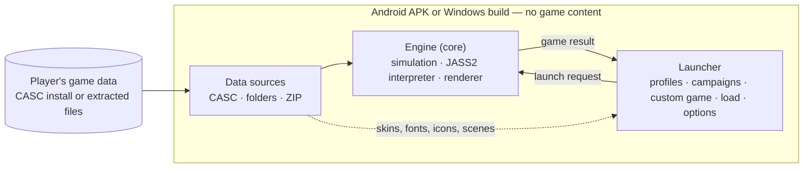

<p align="center">
  <b>W3 on Windows and on Android phones and tablets: an engine and a launcher that play from your own copy of the game.</b>
</p>

<p align="center">
  
  
  
  
  
  
</p>

> [!IMPORTANT]
> **This project contains no game content.** The Android APK and the Windows build hold the engine and the launcher only.
> Models, textures, sound, music, maps, campaigns, movies and texts are read at run time from **your own, legally
> owned copy of W3**, whose folder you choose when the app starts for the first time.
> No game data is distributed here and none may be requested here.
>
> This project is not affiliated with or endorsed by Blizzard Entertainment.

## Contents

- [What it is](#what-it-is)
- [Screenshots](#screenshots)
- [Feature status](#feature-status)
- [Requirements](#requirements)
- [Installing and supplying the game files](#installing-and-supplying-the-game-files)
- [How it fits together](#how-it-fits-together)
- [Building](#building)
- [Tests](#tests)
- [Project layout](#project-layout)
- [Status and roadmap](#status-and-roadmap)
- [Credits](#credits)
- [Licence and legal notice](#licence-and-legal-notice)

## What it is

Warsmash Reforged is a continuation of Retera's [Warsmash](https://github.com/Retera/WarsmashModEngine) engine for Windows
and Android. It has two parts:

- **The engine** — a Java 17 / [libGDX](https://libgdx.com/) engine that reads the game's own data (CASC install or
  extracted files), runs the game simulation and the map scripts in its own JASS2 interpreter, and draws the game
  with OpenGL ES shaders. This fork adds touch and S Pen controls, the campaign flow, save and load, cinematics,
  graphics sets (Classic, HD, Reforged), determinism work for replays, and the memory and speed work needed on phones.
- **The launcher** — the front end that replaces the engine's own menus: game data check, player profiles,
  campaign and mission lists, Custom Game, Load Game, Options, Help and the result page after every campaign
  mission. It is built from your game data in either the Classic or the Reforged look, and the same launcher
  runs on Android (native views) and on Windows.

The aim is to play W3 on phones and tablets with classic graphics at a steady 30 FPS on weaker devices and up to
120 FPS on faster ones, with game rules as close to the original as measurements allow.

## Screenshots

<table>
  <tr>
    <td width="50%"><br><sub>Launcher — Reforged look</sub></td>
    <td width="50%"><br><sub>Launcher — Classic look</sub></td>
  </tr>
  <tr>
    <td width="50%"><br><sub>Human campaign, Chapter One: loading screen</sub></td>
    <td width="50%"><br><sub>Human campaign, Chapter One: in game</sub></td>
  </tr>
  <tr>
    <td width="50%"><br><sub>Custom game: loading screen</sub></td>
    <td width="50%"><br><sub>Custom game: Human base at the start</sub></td>
  </tr>
</table>

<p align="center"><sub>The engine on Windows with the user's own game data; game art © Blizzard Entertainment.</sub></p>

## Feature status

Legend: **Working** — used in the regular test runs or played on real devices ·
**In progress** — partly built, not finished or not fully verified · **Planned** — decided, not built · **Not planned** — will never be implemented.

| Area | Feature | Status | Notes |
|---|---|---|---|
| Game data | Game data folder screen and check on first start | Working | CASC install or extracted files; 1.31 and newer, including Reforged |
| Game data | Import ZIP of prepared data | Working | Classic data plus the graphics set ZIPs |
| Launcher | Home, player profiles, Options, Help | Working | Classic and Reforged look |
| Launcher | Campaign and mission lists | Working | Reign of Chaos and The Frozen Throne, grouped by game; campaign version and difficulty |
| Launcher | Custom Game, Load Game | Working | Save filter on Load Game |
| Launcher | Result page after every campaign mission, Continue to the next | Working | Scores, hero, time and difficulty; both looks |
| Launcher | Windows launcher | Working | Same pages and recorded scenes as on Android |
| Launcher | View Replay | In progress | Page is there; recording and playback are being built |
| Game | Campaigns: cinematics, missions, victory and defeat, carry-over to the next mission | Working | Every Reign of Chaos and The Frozen Throne mission can be completed; tweaking required |
| Game | Forsaken Kingdom campaigns | Planned | Listed as coming soon; needs Reforged 3.0 data |
| Game | Custom games against computer players | Working | Full melee AI (expanding, buying items, attack waves) is planned |
| Game | Save and load, also from the main menu | Working | |
| Game | Cinematics: campaign intro, opening and ending movies | Working | Windows x64 and Android |
| Graphics | Classic, HD and Reforged graphics sets | Working | Custom games use the chosen set; campaigns follow the campaign version |
| Controls | Full touch control; S Pen | Working | |
| Rules | Unit behaviour, combat, spells, abilities and timings | In progress | Measured against the original and calibrated step by step |
| Simulation | Determinism and replays | In progress | |
| Performance | Frame rate on phones and tablets | In progress | |
| Multiplayer | LAN | Planned | |
| Multiplayer | Online multiplayer | Not planned | Will never be implemented |

## Requirements

**To play**

- An Android phone or tablet with Android 8.0 (API 26) or later (`arm64-v8a`, `armeabi-v7a` or `x86_64`).
  Development devices are a Samsung Galaxy Tab S8 Ultra, a Galaxy S20+ and a Galaxy S23 Ultra.
- Or a Windows PC with Java 17 (movies need Windows x64).
- Your own copy of W3, version 1.31 or newer (including Reforged): an installed game folder (CASC) or files
  extracted from it, for example with the [Reforged Extractor toolkit](https://github.com/nikoltu/W3-Android-prep-tool).
  Tested with 1.31.1, 1.32.10 (extracted files) and 3.0.1. Older releases that ship MPQ archives (1.29 and earlier)
  are not supported.

**To build**

- JDK 17.
- Android SDK with platform 36 for the Android build.
- Gradle comes with the wrapper (`gradlew`).

## Installing and supplying the game files

### Android

1. Build and install the app (see [Building](#building)), or install an APK from the [Releases](../../releases)
   page when one is attached.
2. Copy the game data to the device: an installed game folder (CASC) or extracted files. The
   [Reforged Extractor toolkit](https://github.com/nikoltu/W3-Android-prep-tool) prepares the data from your own
   copy for this engine. Files copied into the app's own folder
   (`Android/data/com.etheller.warsmash.android/files/data`) are found by themselves.
3. On first start, choose that folder in the **Game data folder** screen with **Choose folder** and tap
   **Continue**. A folder outside the app's own folder needs the **All files access** permission, which the
   screen asks for.
4. Later starts go straight to the launcher. To pick another folder, hold the app icon and choose **Game data**.

The app only reads the game folder. Profiles, saves and settings are kept in the app's own storage.

### Windows

Without a map argument the program opens on its launcher, where you choose the game data folder. To start the
engine directly instead:

1. Copy `core/assets/warsmash.ini` to `core/assets/warsmash.local.ini`.
2. Point `[DataSources]` at your game install:

   ```ini
   [DataSources]
   Count=3
   Type00=CASC
   Path00="C:\Path\To\Game"
   Prefixes00=war3.w3mod,war3.w3mod\_deprecated.w3mod,war3.w3mod\_locales\enus.w3mod
   Type01=Folder
   Path01="..\..\resources"
   Type02=Folder
   Path02="."
   ```

3. Run:

   ```bash
   ./gradlew desktop:runGame -Pargs="-window -ini warsmash.local.ini"
   ```

## How it fits together



- Every game start goes through one **launch request** (map or mission, players, difficulty, graphics set);
  every game end leaves one **game result**, from which the launcher shows the result page and starts the next
  mission. A campaign's game cache is carried from mission to mission.
- The engine reads the game data directly through layered data sources. Nothing derived from the retail files is
  packaged; the launcher builds its skins, fonts and buttons on the device from the player's files.
- The simulation is kept separate from rendering and input, which is the basis for save games, replays and, later,
  LAN games.

## Building

| Path | State |
|---|---|
| Windows host, JDK 17, debug APK and Windows build | Tested — this is how every development build is made |
| Release APK (minified) | Tested — `android:assembleRelease`, then signed with your own key (`zipalign` + `apksigner`) |
| Linux / macOS host | Not tested |

**Android:**

```bash
./gradlew android:assembleDebug
./gradlew android:installDebug
```

The libGDX native libraries for each ABI are unpacked into `android/libs` by the build.

**Windows:**

```bash
./gradlew desktop:classes
./gradlew desktop:runGame -Pargs="-window -ini warsmash.local.ini"
```

## Tests

Engine unit tests ([JUnit](https://junit.org/)) run on the host:

```bash
./gradlew core:test
```

180 tests at the time of writing: determinism (simulation checksums, `StrictMath`, handle allocation, static state),
replays, saved games, path finding, player commands and selection, timers, sound timing, data sources and the
launcher's campaign and result logic.

Game rules are also checked against measurements of the original game, and the Android builds are checked on real
devices before every version; those tools are not part of this repository.

## Project layout

```
core/                   engine: simulation, JASS2 interpreter, rendering, launcher logic shared by both platforms
  src/com/etheller/warsmash/launcher/    launch request, game result, campaigns, skins, profiles
  src/com/etheller/warsmash/viewer5/     model and terrain rendering, game simulation
  assets/               engine settings, shaders, icons
  test/                 unit tests
android/                Android app: launcher pages, data folder screen, engine activity
desktop/                Windows launcher and engine start (LWJGL)
shared/                 networking protocol shared by client and server
server/                 game server (inherited from Warsmash)
jassparser/             JASS2 grammar (ANTLR)
fdfparser/              FDF interface definition grammar (ANTLR)
resources/              engine-side scripts and interface files
jars/                   bundled libraries
docs/images/            images used in this file
```

## Status and roadmap

Current version: **v0.3.13**

- **Custom games:** work end-to-end.
- **Campaigns:** Reign of Chaos and The Frozen Throne can be completed to the end. Tweaking required.
- **Controls:** full touch screen control, with S Pen support.
- **Launcher:** built from your own game data, with Campaign, Custom Game, Load Game, Options and Help; the same
  launcher on Android and Windows.
- **Cinematics:** campaign intro, opening and ending movies play from the game data (Windows x64 and Android).
- **Save and load**, also from the main menu.

Next: determinism and replays, then full melee AI for all four races, performance on phones, LAN games and
calibration of the remaining rules.

Known issues: Forsaken Kingdom campaigns cannot be played yet; movies on Windows need the x64 build of Java.

## Credits

- **[Retera](https://github.com/Retera)** for [Warsmash](https://github.com/Retera/WarsmashModEngine), the engine this
  repository continues, and everyone who contributed to it.
- **[libGDX](https://libgdx.com/)** with `gdx-freetype`, **LWJGL 2**, **ANTLR 4**, **Gson**, **Guava**,
  **Apache Commons Compress and IO**, and **FFmpeg** (JavaCPP) for movies on Windows, each under its own licence.

## Licence and legal notice

The engine and the launcher are free software under the **GNU Affero General Public License, version 3**, same as
upstream; see [`LICENSE`](LICENSE). Third-party components keep their own licences.

W3, its models, textures, sound, music, maps, campaigns, movies and texts are the property of Blizzard
Entertainment, Inc. They are **not** part of this repository or of any package built from it, and are not covered
by the licence above. To use this engine you must own the game and supply its files yourself. Do not ask for, post
or link game data in this project's issues or discussions.

This is an independent, non-commercial project. It is not affiliated with, endorsed by or sponsored by Blizzard
Entertainment. Blizzard Entertainment is a trademark or registered trademark of Blizzard Entertainment, Inc.
